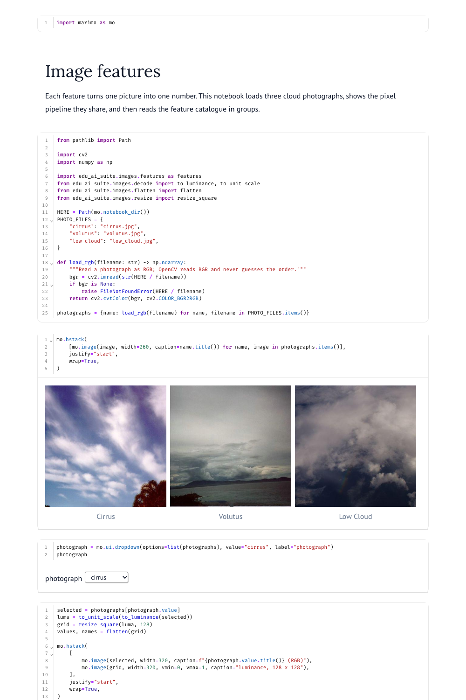
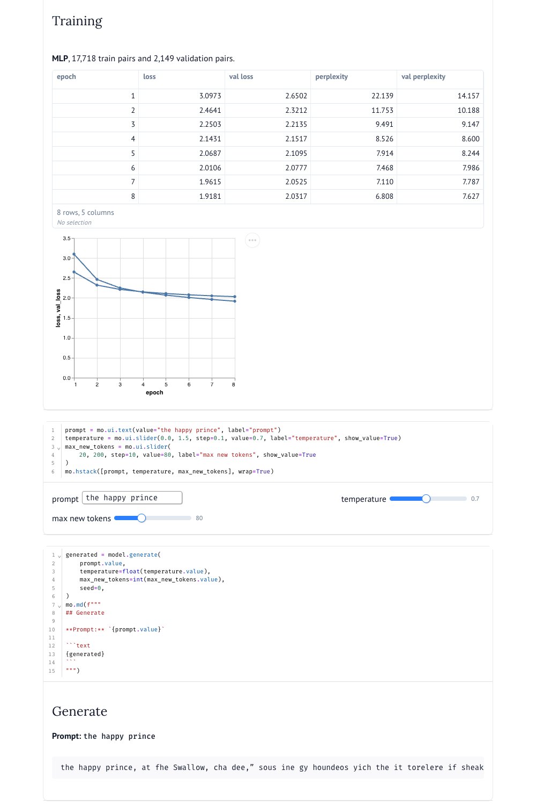
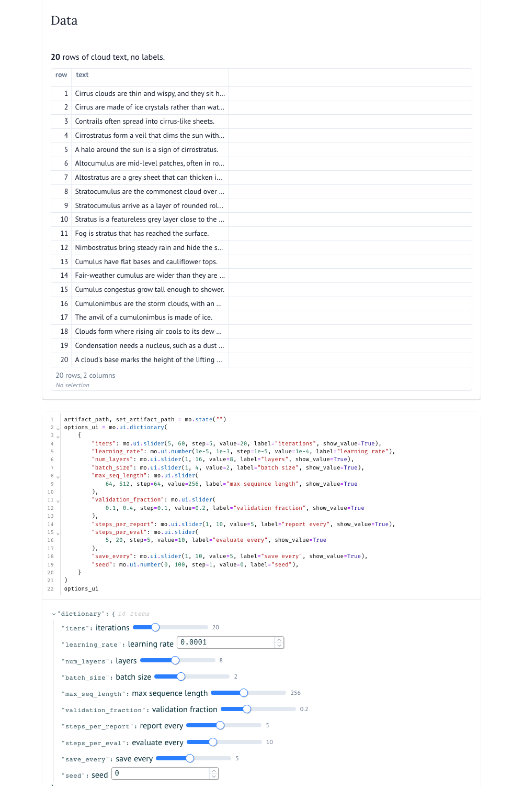

# edu-ai-suite

A plain-Python teaching library for image features, tiny language models and LoRA
fine-tuning, with Hugging Face assets: cloud photographs, digits, and an LLM small
enough to fine-tune on a 16 GB Mac.

- Each image feature turns a picture into one number, such as `mean_intensity`,
  `edge_density`, `coarse_texture` and `left_right_symmetry`.
- Each language model is a tokenizer and an architecture fitted to text, which then
  generates more text.
- Each LoRA run takes a pre-trained model and produces an adapter.

Only the LoRA component needs MLX, and therefore Apple Silicon.

## Contents

- **`edu_ai_suite/images/`** - the image pipeline: `decode`, `resize`, `flatten` and
  `pixels`, and the `features` package built on them: one class per feature, the groups
  that select them, extraction, and the generated guide.
- **`edu_ai_suite/lm/`** - the character and word tokenizers with their stats, pairs,
  the bigram/MLP/LSTM architectures, training options and results, and `LanguageModel`,
  which carries its tokenizer, so one directory holds everything a model needs.
- **`edu_ai_suite/lora/`** - LoRA fine-tuning of an MLX base model: options, data, the
  train/validation split, the run, and the adapter and model objects that read it back.
- **`edu_ai_suite/text/`** - a plain-text utility: cleaning, sentence and paragraph
  splitting, and Q/A parsing, behind one facade.
- **`edu_ai_suite/assets/`** - the Hugging Face assets, each behind a download function
  that caches and verifies it, and the command-line interface over them.
- **`examples/`** - three marimo notebooks, one per subject, with their photographs and
  text file.
- **`scripts/notebooks.py`** - runs the notebooks and writes the README screenshots.
- **`tests/`** - the test suite, in plain Python.
- **`GLOSSARY.md`** - definitions of key words.

## Installation

Requirements: Python 3.11+, and macOS on Apple Silicon for LoRA training.

Everything except LoRA is a plain dependency: OpenCV for the image pipeline, Keras on a
TensorFlow backend for the from-scratch language models. Only LoRA is an extra, because
it uses MLX, which is specific to Apple Silicon.

```bash
pip install edu-ai-suite            # everything but LoRA
pip install "edu-ai-suite[lora]"    # plus LoRA (Apple Silicon)
```

Development, from the repository root:

```bash
uv sync
uv run pytest
uv build
```

## Notebooks

The examples are marimo notebooks. Each notebook is the runnable example, and the
screenshot below is that same notebook with its code and outputs. The notebooks live in
the repository; the wheel contains the library.

| Notebook | Shows | Needs |
|---|---|---|
| [Image features](https://github.com/tcorbettclark/edu-ai-suite/blob/main/examples/image_features.py) | the pixel pipeline, the catalogue, groups, extraction, ablation and the feature guide | - |
| [Language models](https://github.com/tcorbettclark/edu-ai-suite/blob/main/examples/language_models.py) | cleaning, tokenizer, pairs, architecture, training, generation, evaluation and save/load | - |
| [LoRA fine-tuning](https://github.com/tcorbettclark/edu-ai-suite/blob/main/examples/lora.py) | data, options, run events, the artifact, and the adapter off and on | Apple Silicon and the `lora` extra |

### Image features

[](https://github.com/tcorbettclark/edu-ai-suite/blob/main/examples/image_features.py)

The notebook loads three CCSN cloud photographs, shows the luminance and resize steps,
and reads the feature catalogue in groups. It then extracts a row, shows one feature's
description, excludes a feature to show ablation, and opens the generated guide.
Credits for the photographs are in `examples/CREDITS.md`.

### Language models

[](https://github.com/tcorbettclark/edu-ai-suite/blob/main/examples/language_models.py)

The notebook cleans Oscar Wilde's *The Happy Prince and Other Tales* (Project Gutenberg
#902, public domain), builds a character or word tokenizer, shows the pair table, and
trains one of `Bigram`, `MLP` or `LSTM`. It then generates text, scores in-domain and
out-of-domain text, and saves and reloads the model. The source and its credit are in
`examples/happy_prince.txt` and `examples/CREDITS.md`.

### LoRA fine-tuning

[](https://github.com/tcorbettclark/edu-ai-suite/blob/main/examples/lora.py)

The notebook fetches the pinned 4-bit BritLLM model, turns the cloud corpus into rows,
and trains an adapter. It shows the run's events, saves the artifact, then loads it and
compares the base model with the adapter on generation and perplexity. The training
button runs a short job; the rest of the notebook works with an artifact from that run
or from a directory you paste in.

## Running the notebooks

From a clone of the repository:

```bash
uv sync
uv run marimo edit examples/
```

Each notebook also runs as a script:

```bash
uv run python examples/image_features.py
uv run python examples/language_models.py
uv run --extra lora python examples/lora.py
```

The notebooks need `marimo`; the package itself does not. The developer environment
installs it, and the LoRA notebook needs the same extra as the rest of LoRA.

## Reference

### Image feature groups

Each feature is a class in `edu_ai_suite.images.features.catalogue`, carrying its own
name, description sentence and computation. Groups are membership lists over that flat
catalogue (`edu_ai_suite.images.features.groups`): a feature can belong to more than one
group, and the grouping never touches the feature itself.

| Group | Count | What it describes |
|---|---|---|
| A | 6 | Global photometry: brightness, contrast, skewness, kurtosis, bright fraction |
| B | 10 | Row/column/diagonal profile summaries: trend, roughness, peaks, crossings |
| C | 6 | Spatial mass: centre of mass, spread, elongation, radial gradient |
| D | 6 | Texture: gradient, edge density, fine/coarse texture, autocorrelation width |
| E | 3 | Topology: hole count, foreground area, stroke crossings |
| F | 3 | Symmetry: left-right, top-bottom, quadrant similarity |
| G | 4 | Colour (opt-in): bluish fraction, the blue-red balance, colourfulness, greenery |

Groups A-F run on a preprocessed luminance image. Group G reads colour directly and is
off by default. `feature_guide_markdown` returns the guide shown in the image notebook
as one Markdown page, generated from the same feature classes as the values.

### Datasets

```python
import edu_ai_suite.assets as assets

britllm = assets.get_britllm()  # a 4-bit MLX snapshot, 1.40 GB
mnist = assets.get_mnist()  # <root>/train, <root>/val: 28x28, 500/100 per digit
clouds = assets.get_clouds()  # <root>/ac, sc, cu, cb, ci + CREDITS.md
```

`get_britllm`, `get_mnist` and `get_clouds` each download, prepare and verify one pinned
Hub asset. The source and the prepared tree are cached; repeated calls are offline.

- `britllm-4bit` - [tcorbettclark/britllm-3b-v0.1-4bit-mlx](https://huggingface.co/tcorbettclark/britllm-3b-v0.1-4bit-mlx),
  a 4-bit affine conversion of `britllm/britllm-3b-v0.1` (2.67B parameters, 1.40 GB),
  verified against the SHA-256 of its weights file. It keeps the source model's ODC-BY
  licence; `scripts/build_britllm_4bit.py` builds and optionally publishes it.
- `mnist-digits` - [ylecun/mnist](https://huggingface.co/datasets/ylecun/mnist)
  (MIT), 60k/10k parquet; `get_mnist` keeps 500/100 per digit at the source
  28x28 resolution in the folder-per-label layout.
- `ccsn-clouds` - [aduuuuuu/CCSN](https://huggingface.co/datasets/aduuuuuu/CCSN)
  (MIT mirror; the CCSN database itself is CC0), the five genera Ac, Sc, Cu,
  Cb and Ci at 256x256, with `CREDITS.md`. Cite Zhang et al. (2018), *CloudNet*.

The `assets` command lists each asset with its type, size, cache status and repo;
`fetch` is idempotent and prints the usable path:

```bash
assets list
assets fetch britllm-4bit
assets fetch mnist-digits
assets fetch ccsn-clouds
```

The same interface is available as `python -m edu_ai_suite.assets`.

### Notebook tooling

`scripts/notebooks.py` runs the examples and regenerates the screenshots:

```bash
uv run python scripts/notebooks.py check
uv run --extra lora python scripts/notebooks.py run
uv run --extra lora python scripts/notebooks.py screenshots
```

`check` runs `marimo check --strict`; `run` executes every notebook through a temporary
HTML export; `screenshots` writes `docs/screenshots/<name>.png`. Use `--only NAME` to
work on one notebook. The screenshots use Playwright with Chromium, falling back to a
system Chrome; install the browser with `uv run playwright install chromium` if needed.

## License

MIT for the code in this repository.

Third-party material keeps its own terms: MNIST is MIT, the CCSN cloud database is CC0,
downloaded text keeps its own licence, and the 4-bit BritLLM artifact keeps the source
model's ODC-BY licence.
